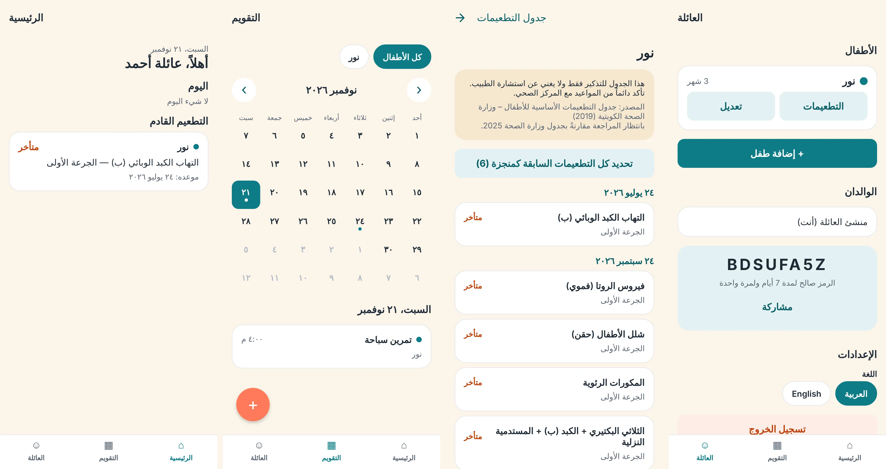

# Yahal · ياهل

A family organiser for parents in Kuwait: each child's profile, a shared
calendar, and the Ministry of Health vaccination schedule, in Arabic and
English. See [`docs/PRD.md`](docs/PRD.md) and [`docs/BUILD-PLAN.md`](docs/BUILD-PLAN.md).



## What's in this repository

```
kids-app/
├── apps/
│   └── mobile/                 The phone app (React Native + Expo, TypeScript)
│       ├── src/app/            Screens. Every file here is one screen.
│       │   ├── (auth)/         Language → phone number → SMS code
│       │   ├── (onboarding)/   Create or join a family → add the first child
│       │   ├── (tabs)/         The bottom tabs: Home, Calendar, Family
│       │   ├── child/          Add / edit a child
│       │   ├── event/          Add / edit a calendar event
│       │   ├── vaccines/       A child's full vaccination schedule
│       │   └── dose/           One vaccine dose: mark given / change date
│       ├── src/components/     Shared pieces (buttons, fields, date picker, forms)
│       ├── src/lib/            Supabase connection, all database calls (api.ts),
│       │                       Arabic/English text (i18n/strings.ts), helpers
│       ├── assets/             App icon and logo
│       └── .env.example        The two PUBLIC settings the app needs
├── supabase/                   The server side
│   ├── migrations/             Database tables + all security rules (SQL)
│   ├── tests/                  Security tests: one family can't see another
│   ├── perf/                   Query-plan check with 5,000 test families
│   └── config.toml             Local Supabase settings (phone sign-in on)
└── docs/                       Product doc, build plan, brand, explanations
    └── explain/                Plain-language notes on each part that's built
```

## How it is secured

- **Sign-in:** Supabase Auth with the parent's phone number and a one-time SMS
  code. There is no password system of our own.
- **Permissions live in the database.** Every table has Row Level Security
  rules (`supabase/migrations/`). A parent can only ever read or change their
  own family's rows, even if the app had a bug. `supabase/tests/security.test.sql`
  proves it with 33 checks.
- **No secrets in the app.** The app only gets the Supabase URL and the public
  "anon" key, from environment variables. The service key, database password
  and SMS provider token stay on the server.
- **Children's data is basic only:** first name, birth date, gender, optional
  nationality group and a calendar colour. No civil ID or passport numbers.

## Run it on your computer

You need [Node.js](https://nodejs.org) 20+ and [Docker Desktop](https://www.docker.com/products/docker-desktop/).

```bash
# 1. Start a local Supabase (database + sign-in) and load the tables
cp supabase/.env.example supabase/.env
npx supabase start          # prints the API URL and the anon key

# 2. Start the app
cd apps/mobile
cp .env.example .env        # paste the anon key from step 1
npm install
npx expo start              # press "w" for web, or scan the QR code with Expo Go
```

Sign in with the test number **5000 0001** (or 5000 0002 / 5000 0003) and the
code **123456**. Test numbers only work on the local server; no SMS is sent.

### Checks

```bash
npx supabase test db                      # security tests (from the repo root)
cd apps/mobile && npm run typecheck && npm test
```

## Where each build step is explained

- [Step 1: sign-in, family, children, calendar and vaccinations](docs/explain/01-family-children-calendar.md)
- [Step 2: security fixes before launch](docs/explain/02-security-hardening.md)
- [Step 3: reminders, repeating events and notification settings](docs/explain/03-reminders.md)
