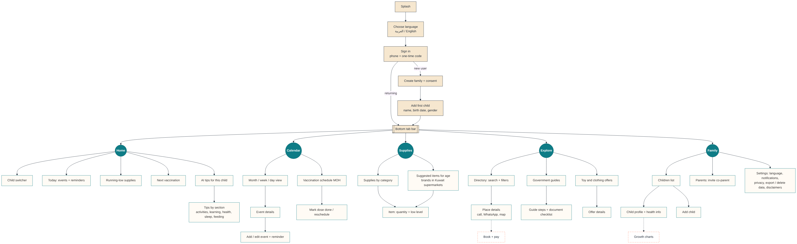

# Yahal · ياهل — Build plan (MVP)

| | |
| --- | --- |
| **Companion to** | [`PRD.md`](PRD.md) (product requirements, v0.2) |
| **Status** | Draft v0.1 — for Ezzo's review |
| **Date** | 21 November 2026 |

This document answers five questions before building starts:
1. What is in the MVP, and what is delayed?
2. What are the screens, and how does a parent move between them?
3. What types of users are there, and what can each one do?
4. What data do we store, and which of it is sensitive?
5. Which technology, server and database should we use, why, and what will it cost each month?

---

## 1. Features: MVP vs. delayed

### 1.1 MVP (Phase 1) — what the first release includes

| # | Feature | What the parent can do |
| --- | --- | --- |
| 1 | **Sign-in and family** | Sign in with a Kuwaiti mobile number and a one-time code; create a family; invite the second parent. |
| 2 | **Arabic / English** | Use the whole app in Arabic (right-to-left) or English; switch any time. |
| 3 | **Child profiles** | Add several children with first name, birth date, gender and optional basics (photo, blood type, allergies, conditions, doctor, nursery/school, sizes). No ID numbers. |
| 4 | **Calendar** | See each child's events by day, week or month; add training, classes, appointments or any activity; repeat events; reminders for both parents. |
| 5 | **Vaccinations (MOH)** | Get the Kuwait MOH vaccination schedule generated for each child from birth to 10; mark doses done or reschedule; reminders before each dose. |
| 6 | **Supplies tracker** | Keep a per-child list (milk, diapers, wipes, thermometer, nasal aspirator, teethers, educational toys, clothing); set a "low" level; get "running low" and "missing" reminders. |
| 7 | **Suggested supplies and brands** | See an age-based starter list with brands sold in Kuwait's big supermarkets; clothing, milk and diapers adapt to the child's gender. |
| 8 | **Government guides** | Read step-by-step guides (birth certificate, civil ID, passport, residency, health centre, nursery/school registration) for Kuwaitis and residents, with document checklists. |
| 9 | **AI tips per child** | Get tips for each child by age: activities, learning, health, sleep and feeding, built on a reviewed content library. |
| 10 | **Directory (read-only)** | Search and filter activities, nurseries, schools, hospitals, paediatricians, toy and clothing stores; call, WhatsApp or open the map. |
| 11 | **Offers (curated)** | See toy and kids' clothing offers added by our team, filtered by age, size and gender (no formula promotions). |
| 12 | **Notifications** | Reminders, low supplies and vaccinations, with per-type on/off and quiet hours. |
| 13 | **Privacy controls** | Read the privacy notice and disclaimers; export or delete all family data. |
| 14 | **Admin panel (web)** | Our team manages the directory, offers, guides, AI content, vaccination schedule versions and brand list, with a review step before publishing. |

### 1.2 Delayed features

| Phase | Feature | Why it waits |
| --- | --- | --- |
| **2** | Booking and payment (KNET, Apple Pay, cards) | Needs signed partners, a payment gateway and legal review. |
| **2** | Partner portal (listings, availability, bookings, payouts) | Comes with booking. |
| **2** | Commissions, incl. doctors and clinics | Needs Ministry of Health and legal checks. |
| **2** | Partner exclusive discounts and promo codes | Comes with partners. |
| **2** | Ratings and reviews (verified bookings only) | Needs bookings first. |
| **2** | AI chat assistant | The MVP uses tips first; chat needs more safety testing. |
| **2** | Caregiver access (grandparent, nanny) | Lower priority; adds permission complexity. |
| **2** | Growth charts (weight, height) | Nice to have; not essential at launch. |
| **2** | Usage prediction for supplies ("diapers run out in ~4 days") | Needs usage history. |
| **2** | Sync with the phone's calendar | Not essential for launch. |
| **2** | Expiry reminders for civil ID and passport | Needs the expiry date only (no numbers); after the guides prove useful. |
| **3** | Premium family subscription | After the free app has users. |
| **3** | Reorder links to partner stores | Needs store partnerships. |
| **3** | Personalised offers by size and age | Needs partners and consent design. |
| **3** | Kids' Corner (Buddy) for children | Child-facing; needs parental controls. |
| **3** | Milestones and memories journal | Nice to have. |

---

## 2. Screen map and navigation

*Source: [`diagrams/screen-map.mmd`](diagrams/screen-map.mmd) (Mermaid). Dashed red boxes are Phase 2.*

### 2.1 Navigation rules

- **First launch:** Splash → choose language → sign in with phone + code → create family and accept the privacy notice → add the first child → Home. Returning parents go straight to Home.
- **Five bottom tabs:** Home · Calendar · Supplies · Explore · Family. In Arabic the tab order is mirrored (right to left).
- **Child switcher** at the top of Home, Calendar and Supplies: "All children" or one child. The choice is remembered between tabs.
- **Floating "+" button** on Calendar and Supplies to add an event or an item fast.
- **Notifications open the exact screen** (for example, a vaccine reminder opens that dose; a low-supply alert opens that item).
- **AI tips** appear on Home and inside each relevant screen (sleep and feeding tips in the child profile, activity tips in Explore), always for one child.
- **Disclaimers** appear on every health, feeding, sleep and vaccination screen.

### 2.2 Screen list

| Tab | Screens |
| --- | --- |
| Start | Splash, Language, Sign in (phone), Code check, Create family + consent, Add first child |
| Home | Today (events, low supplies, next vaccine, tip of the day), Tips by section |
| Calendar | Month/Week/Day, Event details, Add/Edit event, Vaccination schedule, Dose details |
| Supplies | Supplies by category, Item details/edit, Suggested items for age (with brands) |
| Explore | Directory search + filters, Place details, Guides list, Guide steps, Offers feed, Offer details |
| Family | Children list, Child profile, Add/Edit child, Parents & invite, Settings (language, notifications, privacy, export/delete, about) |
| Admin (web) | Sign in, Directory, Offers, Guides, AI content, Vaccination schedules, Brands & products, Staff accounts, Audit log |

About **30 app screens** and **9 admin screens** in the MVP.

---

## 3. User types and permissions

### 3.1 User types

| Type | Who | Phase |
| --- | --- | --- |
| **Visitor** | Someone who opened the app but hasn't signed in | MVP |
| **Family owner** | The parent who created the family | MVP |
| **Co-parent** | The second parent, invited by the owner | MVP |
| **Caregiver** | Grandparent or nanny, with limited access | Phase 2 |
| **Content editor** | Our team: adds and edits directory, offers, guides, brands, tips | MVP |
| **Health reviewer** | A paediatrician/health advisor who approves health content and the vaccination schedule | MVP |
| **Super admin** | Ezzo / technical owner: staff accounts, settings, security | MVP |
| **Partner** | Clinic, nursery, academy, store staff | Phase 2 |

### 3.2 Permissions

✅ = allowed · 👁 = view only · ❌ = not allowed

| Action | Visitor | Family owner | Co-parent | Caregiver (P2) | Content editor | Health reviewer | Super admin | Partner (P2) |
| --- | --- | --- | --- | --- | --- | --- | --- | --- |
| Browse guides, directory, offers | ✅ | ✅ | ✅ | ✅ | ✅ | ✅ | ✅ | ✅ |
| Add / edit / remove children | ❌ | ✅ | ✅ | ❌ | ❌ | ❌ | ❌ | ❌ |
| See child health info | ❌ | ✅ | ✅ | ❌ (unless allowed by owner) | ❌ | ❌ | ❌ (\*) | ❌ |
| Calendar events | ❌ | ✅ | ✅ | 👁 + mark done | ❌ | ❌ | ❌ | ❌ |
| Supplies | ❌ | ✅ | ✅ | 👁 + update quantity | ❌ | ❌ | ❌ | ❌ |
| Invite / remove family members | ❌ | ✅ | ❌ | ❌ | ❌ | ❌ | ❌ | ❌ |
| Export family data | ❌ | ✅ | ✅ | ❌ | ❌ | ❌ | ❌ | ❌ |
| Delete the whole family account | ❌ | ✅ | ❌ | ❌ | ❌ | ❌ | ❌ (\*) | ❌ |
| Edit directory, offers, guides, brands | ❌ | ❌ | ❌ | ❌ | ✅ (draft) | ❌ | ✅ | Own listing / offers only |
| Edit AI tips and health content | ❌ | ❌ | ❌ | ❌ | ✅ (draft) | ✅ | ✅ | ❌ |
| Publish health content / vaccination schedule | ❌ | ❌ | ❌ | ❌ | ❌ | ✅ | ❌ | ❌ |
| Publish non-health content | ❌ | ❌ | ❌ | ❌ | ✅ | ✅ | ✅ | ❌ |
| Manage staff accounts and roles | ❌ | ❌ | ❌ | ❌ | ❌ | ❌ | ✅ | ❌ |
| View audit log | ❌ | ❌ | ❌ | ❌ | ❌ | ❌ | ✅ | ❌ |
| See bookings (P2) | ❌ | Own | Own | ❌ | ❌ | ❌ | ✅ | Only their own bookings: child first name, age, parent contact |

(\*) Staff never browse family data. A super admin can act on a family's data only to fulfil that family's own support or deletion request, and every such action is written to the audit log.

These rules are enforced **in the database** (row-level security), not only in the app, so a bug in a screen can't leak another family's data.

---

## 4. Data we store and how sensitive it is

### 4.1 Sensitivity levels

| Level | Meaning | Protection |
| --- | --- | --- |
| 🟢 **Public** | Content anyone can see | Normal |
| 🟡 **Internal** | Business data, not about families | Staff access only |
| 🟠 **Personal** | Identifies a parent or a child | Encrypted at rest, family-only access, never sold, deleted on request |
| 🔴 **Sensitive** | Children's health information, photos and anything that could harm a child if leaked | Everything for Personal **plus** field-level encryption, never sent to AI or partners, never in logs or analytics |

### 4.2 What we store

| Data | Examples | Level | Notes |
| --- | --- | --- | --- |
| Parent account | Name, mobile number, language, notification settings | 🟠 | Phone used for sign-in only. |
| Family links | Which parents and children belong together, roles | 🟠 | |
| Child basics | First name, birth date, gender, nationality group (Kuwaiti/GCC/other) | 🟠 | Needed for schedules, tips and guides. |
| Child health | Blood type, allergies, chronic conditions, doctor's name, vaccination records | 🔴 | Field-level encryption. |
| Child photo | Profile picture | 🔴 | Private storage, short-lived links, optional. |
| Child sizes | Clothing, shoe and diaper size | 🟠 | Used for supplies and offers. |
| Calendar events | Title, date, place, notes, reminders | 🟠 | Notes can contain anything, so treated as personal. |
| Supplies | Items, brands, quantities, low levels | 🟠 | |
| Guide progress | Which steps are done per child | 🟠 | No document numbers or scans. |
| AI tip history | Which tips were shown, likes/dislikes | 🟠 | Children's details are not kept in AI logs. |
| Consent records | Privacy notice version accepted, date | 🟠 | Needed to prove consent. |
| Device tokens | Push notification tokens | 🟠 | Deleted when the parent signs out. |
| Directory, guides, offers, tips library, vaccination schedule, brand list | Content | 🟢 | Published content. |
| Staff accounts, audit log, drafts | Admin data | 🟡 | |
| Anonymous usage stats | Screen views, feature use (no names) | 🟡 | Opt-in analytics, no children's data. |

### 4.3 What we do **not** store

- Civil ID, passport or nationality-file numbers, or scans of documents.
- Exact home addresses or live location (the map uses the location only on the phone, while searching).
- Card numbers (Phase 2 payments go through a licensed gateway).
- Children's chats or messages (no child-facing features in the MVP).

### 4.4 Rules that apply to all personal and sensitive data

- Stored **in Kuwait** (decided), including backups.
- Encrypted in transit (TLS) and at rest; 🔴 fields also encrypted at field level.
- Parents can export or permanently delete their family's data from the app; deletion removes backups within a set period (e.g. 30 days).
- The AI only receives the child's first name, age, gender and the basics needed for a tip, and the redaction module removes phone numbers, emails and civil ID numbers if typed by mistake.
- Legal review against Kuwait's CITRA Data Privacy Protection Regulation and CITRA's cloud and data-classification rules before launch.

---

## 5. Technology, servers and monthly cost

### 5.1 Recommendation

| Layer | Choice | Why |
| --- | --- | --- |
| **Mobile app** | **React Native with Expo** (TypeScript) | One code base for iOS and Android; built-in right-to-left support; over-the-air updates for quick fixes; the same language (JavaScript/TypeScript) as the existing starter server and the admin web app, so one person (and Claude) can work on everything; very large library ecosystem; works well for AI-assisted ("vibe") coding. |
| **Admin panel** | Next.js (React) web app | Shares code, types and translations with the mobile app. |
| **Backend** | **Self-hosted Supabase** (Postgres, Auth with phone sign-in, Storage, row-level security) | Gives us a ready-made sign-in, database and file storage with security rules in the database. Self-hosted because the decision is to keep data in Kuwait, and Supabase's managed cloud has no Kuwait region. |
| **Database** | **PostgreSQL** | Relational data fits well (families → children → events/supplies); strong row-level security; indexes and query plans per the performance standard. |
| **Server / hosting** | A cloud region in Kuwait — **Google Cloud's Kuwait region** or **Microsoft Azure's Kuwait region** — or a local Kuwaiti data centre if neither fits | Both have announced Kuwait regions ([Google](https://cloud.google.com/blog/products/infrastructure/bringing-a-new-google-cloud-region-to-kuwait/), [Microsoft](https://datacenterdynamics.com/en/news/microsoft-to-develop-azure-cloud-region-in-kuwait)). Before signing up, confirm the region is live and which services it offers. |
| **Scheduled reminders** | Postgres-based job queue (e.g. pg-boss) + Expo push notifications | Reminders are scheduled on the server so they are never lost. |
| **AI** | OmniRoute gateway from the starter app, with a pinned model | Already built with child-safety rules and streaming. |
| **Monitoring** | Sentry (errors), uptime checks | Free tiers are enough for the MVP. |

**Why not Flutter?** Flutter is also a strong choice, with excellent performance and RTL support. We recommend Expo because it uses the same language as the rest of the stack (server, admin panel, existing starter app), which means less to maintain. It also has over-the-air updates, and its React ecosystem is the one AI coding tools know best. Flutter would need a separate language (Dart) for the app only.

**Trade-off of self-hosting:** we are responsible for updates, backups and monitoring of the database and Supabase services. The plan includes automated daily backups (kept in Kuwait), monthly restore tests and security updates.

### 5.2 Expected monthly cost (MVP, up to about 5,000 families)

> **These are estimates, not quotes.** They are based on typical published prices for similar services in other regions. Prices for the Kuwait regions were not checked here and may be higher. Confirm with the provider before deciding. 1 KWD ≈ 3.25 USD.

| Item | Estimate (USD / month) | Notes |
| --- | --- | --- |
| Main server (4 vCPU, 16 GB RAM) running Supabase + Postgres | 120 – 200 | One server is enough for the MVP. |
| Backups + file storage (photos), ~100 GB | 5 – 20 | Kept in Kuwait. |
| Data transfer / CDN for images and app content | 10 – 40 | Images in WebP/AVIF keep this low. |
| SMS for sign-in codes | 50 – 200 | Biggest variable cost: depends on sign-ups and SMS price in Kuwait (WhatsApp codes can be cheaper). |
| AI tips (via OmniRoute to the chosen model) | 20 – 100 | Low, because most tips come from the reviewed library and are cached. |
| Expo EAS (app builds and updates) | 0 – 19 | Free tier may be enough at first. |
| Push notifications (Expo / Apple / Google) | 0 | Free. |
| Error monitoring (Sentry) | 0 – 26 | Free tier at first. |
| Apple developer account | ~8 | 99 USD per year. |
| Google Play developer account | ~0 | 25 USD once. |
| Domain + email | 5 – 15 | |
| **Total** | **≈ 220 – 630 USD** (**≈ 70 – 195 KWD**) | Most likely ≈ 300 – 400 USD while the user base is small. |

**Not included:** legal review, a health-content reviewer, design polish, marketing, and a staging server (adds about 40–80 USD/month if we want a full copy for testing; a smaller one is enough).

**As we grow (Phase 2):** a second server or a managed database for high availability (+150–400 USD/month) and payment gateway fees (a percentage per transaction, paid from bookings).

### 5.3 Build order (proposal)

1. Project setup: Expo app, admin app, self-hosted Supabase on a test server, Arabic/English and RTL, CI with tests.
2. Sign-in, family, co-parent invite, child profiles.
3. Calendar + MOH vaccination schedule + reminders.
4. Supplies tracker + suggested items and brands.
5. Government guides + directory + offers (with the admin panel for each).
6. AI tips per child.
7. Privacy controls, performance checks (Slow 4G, 4x CPU), security testing, store submission.

Each step is a pull request for Ezzo to review and merge.

---

## Sources

- Google Cloud — [Bringing a new Google Cloud region to Kuwait](https://cloud.google.com/blog/products/infrastructure/bringing-a-new-google-cloud-region-to-kuwait/)
- DatacenterDynamics — [Microsoft to develop Azure cloud region in Kuwait](https://datacenterdynamics.com/en/news/microsoft-to-develop-azure-cloud-region-in-kuwait)
- Al Tamimi & Co. — [Cloud Computing & Data Classification in the State of Kuwait](https://www.tamimi.com/law-update-articles/cloud-computing-data-classification-in-the-state-of-kuwait)
- CITRA — [Data Classification Policy](https://www.citra.gov.kw/sites/en/LegalReferences/Data_Classification.pdf)
