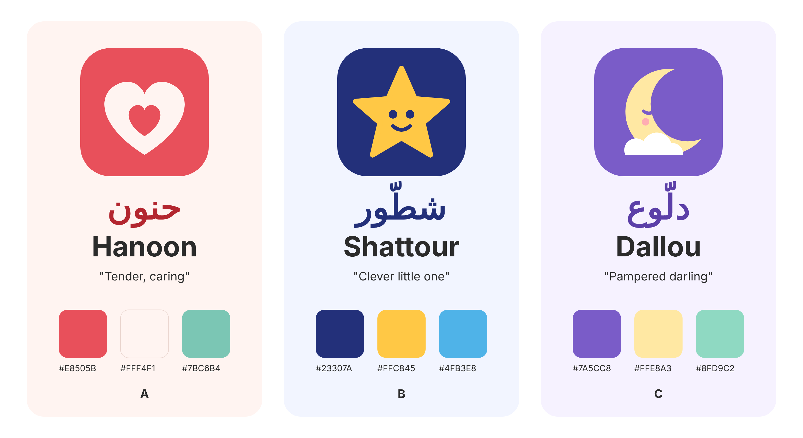
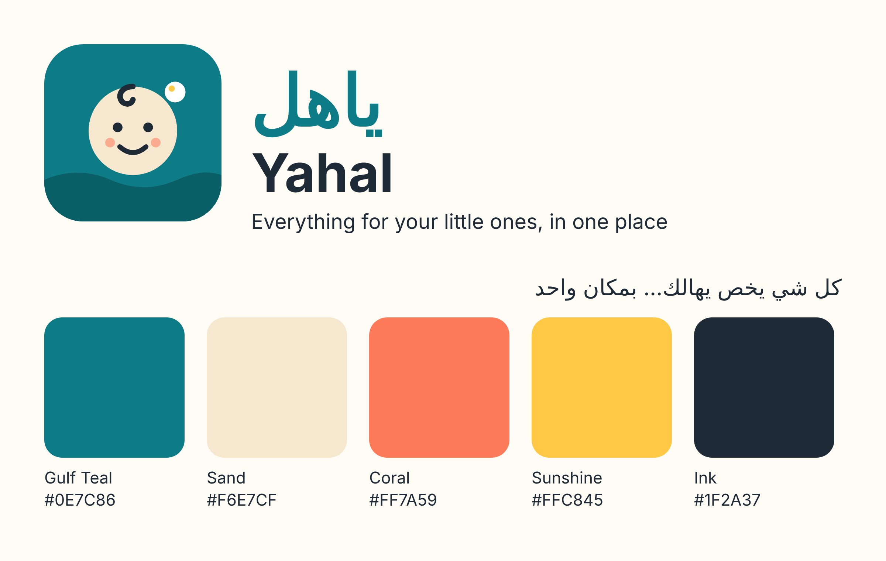

# Kids App for Kuwait — Product Requirements Document (PRD)

| | |
| --- | --- |
| **Working title** | **Yahal · ياهل** (recommended name, see section 16) |
| **Owner** | Ezzo |
| **Status** | Draft v0.2 — updated with Ezzo's decisions (section 15) |
| **Date** | 20 November 2026 (v0.1), 21 November 2026 (v0.2) |
| **Platforms** | iOS and Android (mobile first), web for partners and admin |
| **Languages** | Arabic (default, right-to-left) and English |

---

## 1. The idea in one paragraph

A single app for parents in Kuwait that organises everything about raising a child from birth to age 10. Each child has their own profile. Around that profile the app keeps a calendar (vaccinations, training, and any activity the parents add), tracks the child's supplies and reminds parents what is missing or about to run out, gives step-by-step guides for government paperwork, and connects parents to Kuwait's activities, nurseries, schools, hospitals and paediatricians so they can book directly. Throughout the app, AI gives personalised suggestions for each child separately — the best activities, learning, health, sleep and feeding for that child's age and gender. The app also shows where to find toy stores and the latest kids' clothing offers. Revenue comes from partners: parents get exclusive discounts for booking through the app, and the app earns a commission on every booking or subscription.

### 1.1 Original idea (English translation)

> A kids' app made for the State of Kuwait. It has a calendar for vaccination appointments, training, and any activity the parents add. It tracks the child's things and reminds you what is missing and what is about to run out. It is connected to all of Kuwait's activities for kids, nurseries, schools, hospitals and paediatricians, and you can book through it. There is a profile for each child by gender and age, kept separate with all of its own activities, appointments and supplies — even the papers and government steps if you want to do any government procedure. It always gives you AI suggestions for each child individually in every section, whether activities, education or medical, and of course the best activities for every age, along with guidance on sleep and feeding for every age from birth up to 10 years. It even tells you where the toy stores are. I'm also thinking of talking to these providers so parents can book through me and get discounts, and I take a commission from them on every subscription, whether doctors, activities or education.
>
> Types of milk and diapers and the other important things, like a thermometer, a nasal aspirator, educational toys, teethers and things like that.
>
> Even clothing offers for kids of all ages.

---

## 2. Problem and opportunity

**The problem.** Parents in Kuwait juggle information scattered across WhatsApp groups, Instagram accounts, clinic phone lines, government portals and paper vaccination cards. There is no single place that:

- remembers each child's vaccinations, appointments and activities;
- knows which supplies are running low;
- explains which government steps are needed (for example after a birth) and in what order;
- lists trusted local providers with real availability and booking;
- gives age-appropriate guidance that fits Kuwait's culture and health system.

**The opportunity.** Kuwait has a high birth rate among GCC states, high smartphone use, and families that spend heavily on children's education, activities and healthcare. Providers (clinics, nurseries, academies, activity centres) mainly market through Instagram and want a direct booking channel. A trusted, Arabic-first app can become the default "family organiser" and a marketplace for these providers.

## 3. Goals and non-goals

### Goals
1. Become the one app a Kuwaiti parent opens to manage their children's schedule, health reminders and supplies.
2. Give genuinely useful, age-specific guidance for each child from birth to age 10.
3. Build a two-sided marketplace where parents discover and book local providers, and providers pay for bookings.
4. Earn parents' trust through strong privacy for children's data.

### Non-goals (for now)
- The app is **not** a medical service. It does not diagnose, prescribe or replace a doctor.
- No social network or public posting between parents in the first versions.
- No direct sale or delivery of products by the app itself (it links to stores and offers).
- No children using the app on their own in the MVP. The main app is for parents (see section 13 on the existing "Buddy" app).

## 4. Target users and personas

| Persona | Description | Main needs |
| --- | --- | --- |
| **Noura, first-time mother (28)** | Kuwaiti, baby aged 3 months, works in the public sector. | Vaccination reminders, feeding and sleep guidance, what to buy, birth paperwork. |
| **Ahmad, father of three (38)** | Children aged 2, 6 and 9. | One calendar for all children, booking activities and clinics, school applications. |
| **Maria, expat mother (33)** | Non-Kuwaiti resident, child aged 4, English-speaking. | Finding nurseries and paediatricians, understanding residency and civil ID steps for her child. |
| **Provider (clinic, nursery, academy)** | Business owner or receptionist. | Receiving bookings, showing availability, promoting offers, getting paid. |
| **App admin (Ezzo's team)** | Operations staff. | Approving providers, curating content, managing offers and commissions. |

Primary user (decided): **all** parents and guardians of children aged **0–10** living in Kuwait, whatever their nationality. One family account can have two parents (shared access) and several children.

## 5. MVP vs. future features

> **Confirmed by Ezzo (21 Nov 2026):** booking, payments and commissions (including medical commissions) move to Phase 2. The principle: launch first with features that are useful on day one **without** partners (profiles, calendar, supplies, guides, AI tips), then add the marketplace once enough parents use the app and partners are signed.

| Area | MVP (Phase 1) | Phase 2 | Phase 3 and later |
| --- | --- | --- | --- |
| Account and family | Parent sign-up, family with 2 parents, multiple child profiles | Grandparents / nanny with limited access | — |
| Child profile | Name, birth date, gender, photo, blood type, allergies, notes | Growth tracking (weight, height, head size) with charts | Milestones and memories journal |
| Calendar | Kuwait vaccination schedule auto-generated, custom events, reminders, per-child colour, shared with partner | Sync with phone calendar, recurring training/classes | Calendar events created automatically from bookings |
| Supplies | Per-child checklist by age, quantities, "running low" reminders, suggested items (milk, diapers, thermometer, nasal aspirator, teethers, educational toys) | Usage-rate prediction ("diapers will run out in ~4 days") | Reorder links to partner stores |
| Government guides | Step-by-step guides (birth registration, civil ID, passport, etc.) with document checklists | Progress tracking per child, reminders for renewals (civil ID / passport expiry) | Deep links to official e-services where allowed |
| AI suggestions | Age-based tips per child: activities, learning, health reminders, sleep, feeding | Personalised weekly plan per child, chat with the AI assistant | Suggestions using booking history and nearby providers |
| Directory | Read-only directory of activities, nurseries, schools, hospitals, paediatricians, toy stores, with map, filters, contact buttons | **Booking and payment** with partner providers, reviews and ratings | Provider subscriptions and packages |
| Offers | Curated kids' clothing and toy offers (manually added) | Partner exclusive discounts and promo codes | Personalised offers by child age and size |
| Monetisation | None (focus on growth) | Commission per booking, featured listings | Premium family subscription, sponsored content |

## 6. Feature requirements

Priorities use **P0** (must have for launch), **P1** (should have), **P2** (nice to have).

### 6.1 Family account and onboarding (P0)
- Sign up with mobile number (Kuwait +965 by default) and one-time code; optional Apple / Google sign-in.
- Choose language (Arabic or English) at first launch; can be changed any time.
- Create a family and invite the second parent by phone number or link. Both parents see and edit the same children.
- Onboarding asks only what is needed: child's name, birth date (or due date for expected babies — P1), gender. Everything else is optional.

### 6.2 Child profile (P0)
- **Basic data only (decided):** first name, birth date (age is calculated), gender, and optional basics: photo, nationality group (Kuwaiti / GCC / other, used only to pick the right government guides), blood type, allergies, chronic conditions, paediatrician, nursery or school, clothing and shoe size (P1).
- **No ID numbers.** The app does not ask for or store civil ID, passport or nationality file numbers. Government guides tell parents which documents to bring; they don't collect them.
- Each child has their **own separate** calendar, supplies list, government steps and AI suggestions. A family view combines them.
- Age is calculated automatically and drives the content shown (in weeks for babies, months up to 2 years, then years).
- Growth tracking with WHO growth charts (P1).

### 6.3 Calendar and reminders (P0)
- **Vaccinations (decided):** the source is the **Kuwait Ministry of Health (MOH) national immunisation schedule**, covering every age from birth to 10 years (including school-entry doses). When a child is created, the app generates that schedule for the child's birth date. Parents mark each dose as done (date, clinic) or reschedule. The source and version of the schedule are shown, with a note to confirm with the child's clinic.
- **Custom events:** training, classes, birthdays, doctor visits, school events, any activity. Fields: title, child(ren), date/time, repeat, location, notes, reminder time.
- Views: day, week, month, and per-child filter. Each child has a colour.
- Push notifications for reminders; both parents receive them (configurable).
- Export / sync to the phone's calendar (P1).

### 6.4 Supplies tracker (P0)
- Per-child list of supplies grouped by category: **feeding** (formula/milk type, bottles), **diapering** (diaper brand and size, wipes), **health** (thermometer, nasal aspirator, medicine, saline), **teething** (teethers), **learning and play** (educational toys), **clothing**.
- Suggested starter list based on the child's age; parents can add, remove or edit items.
- **Brand suggestions (decided):** for milk/formula, diapers, wipes and baby-care items, the app suggests **brands that are actually sold in Kuwait's big supermarkets** (for example The Sultan Center, LuLu Hypermarket, Carrefour and the co-operative societies). Examples to verify with a store check before launch: diapers — Pampers, Huggies, Molfix, BabyJoy; formula — Aptamil, Bebelac, NAN, S-26, Similac, Enfamil. Brands are listed neutrally (alphabetical, no paid ranking in the MVP), with sizes and stages by age.
- **Infant formula rule:** formula screens show that breastfeeding is recommended where possible and that a doctor should advise on formula choice, and they carry no promotions or discount codes until the rules on marketing breast-milk substitutes in Kuwait have been checked.
- **Gender (decided):** supply suggestions change by gender **only for clothing, milk and diapers** (for example boy/girl diaper ranges and clothing styles, and gender-specific product lines where a brand offers them). Everything else (calendar, health, sleep, learning, activities, guides) is the same for all children.
- Each item: name, brand, size/type, current quantity, unit, "low" threshold.
- "Running low" and "missing" reminders. Quick "+ / −" buttons to update quantity.
- Size change hints, e.g. "Diaper size 3 usually fits around 6–10 kg — time to check the next size?" (P1).
- Usage-rate prediction and reorder links to partner stores (P1/P2).

### 6.5 Directory and booking (Directory P0, booking P1)
- Categories: **kids' activities** (sports, swimming, arts, coding, Quran, languages), **nurseries**, **schools**, **hospitals and clinics**, **paediatricians**, **toy stores**, **kids' clothing stores**.
- Each listing: name (Arabic/English), category, area/governorate, map location, age range, price range, working hours, phone/WhatsApp, Instagram, photos, licence information where applicable.
- Search and filters: governorate/area, child age, category, price, gender (for gender-specific activities), language, distance.
- **MVP:** read-only listings curated by the team, with call / WhatsApp / directions buttons.
- **Phase 2 booking:** partners publish time slots or packages; parents pick a child, choose a slot, pay (KNET / Apple Pay / cards) or reserve; booking is added to the child's calendar automatically; cancellation and refund rules per partner; ratings and reviews from verified bookings only.
- Partner portal (web): manage listing, availability, bookings, offers, payouts and reports.

### 6.6 Government paperwork guides (P0)
- Step-by-step guides, written in plain Arabic and English, each with: who it applies to (citizens / residents), required documents, where to go (office or e-service), fees if known, typical time, and a checklist.
- **Audience (decided):** all parents living in Kuwait, whatever their nationality. Each guide has a Kuwaiti-citizen version and a resident (expat) version where the steps differ, and the app picks the right one from the child's nationality group.
- Proposed first guides (to be verified with official sources before publishing):
  - Birth notification and birth certificate
  - Civil ID for a newborn (PACI)
  - Adding the child to the nationality / citizenship file (Kuwaiti families)
  - Child's passport
  - Residency for children of expat families
  - Health insurance / health card and registering at the local health centre
  - Nursery and school registration (government and private)
  - Travel permission or consent documents where required
- Each guide shows its **last verified date** and links to the official source. Content is reviewed regularly because procedures change.
- Per-child progress tracking and expiry reminders for civil ID and passport (P1).

### 6.7 AI suggestions per child (P0 basic, P1 personalised)
- AI suggestions appear **inside each section**, always for one specific child, based on age, gender (where relevant) and the profile:
  - **Activities:** best activities for this age, indoor and outdoor, and suitable ones in Kuwait (heat-aware in summer).
  - **Learning:** age-appropriate learning goals and play ideas, Arabic and English language development, early Quran/Islamic learning if the parent opts in.
  - **Health:** upcoming vaccinations, routine check-ups, general well-being tips — never diagnoses.
  - **Sleep:** typical sleep needs and routines by age, from newborn to 10 years.
  - **Feeding:** milk/formula guidance for babies, starting solids, healthy meals by age, allergy awareness.
  - **Supplies:** what to prepare for the next stage.
- MVP approach: a curated, reviewed **content library by age band** (0–3 months, 3–6, 6–12, 1–2 years, 2–3, 3–5, 5–7, 7–10), with AI used to personalise and summarise it for each child. This keeps advice consistent and reviewable.
- Phase 2: a chat assistant parents can ask questions, grounded in the reviewed library, with clear disclaimers and "see a doctor" escalation for health red flags (for example high fever in a baby under 3 months).
- **Data sent to the AI (decided):** only the child's first name, age, gender and the basic profile data needed for the answer. Never ID numbers, phone numbers or addresses. The existing redaction module (section 13) strips any that a parent types by mistake.

### 6.8 Offers: toys and kids' clothing (P1)
- A feed of current offers from toy stores and kids' clothing brands, filterable by child age, size and gender.
- MVP: offers added manually by the team. Phase 2: partners post their own offers and exclusive app discount codes.
- "Where to buy" for toys: nearby toy stores on the map.

### 6.9 Notifications (P0)
- Types: reminders (calendar), low supplies, vaccination due, guide step reminders, booking confirmations (Phase 2), offers (opt-in only).
- Parents control each type, and quiet hours.

### 6.10 Admin panel (P0, internal web)
- Manage listings, offers, government guides, AI content library, vaccination schedule versions, and (Phase 2) partners, commissions and payouts.
- Content review workflow: draft → reviewed → published, with the reviewer and date recorded.

## 7. User stories (selected)

| # | As a… | I want to… | So that… | Priority |
| --- | --- | --- | --- | --- |
| 1 | parent | add each of my children with their birth date and gender | the app shows content that fits each child | P0 |
| 2 | parent of a newborn | see my baby's vaccination schedule automatically | I never miss a vaccine | P0 |
| 3 | parent | add training sessions and activities to a child's calendar with reminders | I don't forget appointments | P0 |
| 4 | parent | share the calendar with my spouse | we both stay in sync | P0 |
| 5 | parent | track diapers and milk and be reminded when they run low | I can buy them before they run out | P0 |
| 6 | new parent | get a checklist of essentials (thermometer, nasal aspirator, teethers…) for my baby's age | I'm prepared | P0 |
| 7 | new parent | follow step-by-step guides for the birth certificate and civil ID | I complete the paperwork without confusion | P0 |
| 8 | parent | get sleep and feeding guidance for my child's exact age | I know what is normal and what to try | P0 |
| 9 | parent | see AI-suggested activities that suit my 6-year-old | I can plan their week | P0 |
| 10 | parent | find paediatricians, nurseries and activities near me | I can choose quickly | P0 |
| 11 | parent | book and pay for an activity or doctor's appointment in the app and get a discount | it is easier and cheaper than calling | P1 |
| 12 | parent | see clothing and toy offers for my child's age and size | I save money | P1 |
| 13 | provider | receive bookings and manage my availability | I get more customers with less admin | P1 |
| 14 | admin | approve providers and review content before it goes live | the app stays trustworthy | P0 |

## 8. Business model

1. **Commission per booking** (Phase 2, decided — not in the MVP): a percentage of each paid booking through the app (doctors, activities, education, nurseries). Typical marketplace rates are 5–15%; the exact rate is to be negotiated per category.
2. **Partner discounts:** partners give app users exclusive discounts in exchange for bookings and visibility. This is the main reason for parents to book through the app instead of directly.
3. **Featured listings and sponsored offers:** partners pay to appear at the top of a category or in the offers feed (clearly labelled "Sponsored").
4. **Premium family subscription (Phase 3, optional):** advanced AI planning, unlimited family members, document vault, extra discounts.
5. **Affiliate links** to online stores for supplies, toys and clothing.

**Important constraint:** medical bookings may be subject to Ministry of Health rules on advertising and fee-sharing with doctors and clinics. Commission on medical bookings must be checked with a lawyer before signing agreements (see Open Questions).

## 9. Success metrics

| Metric | Target (first 6 months after launch, to be confirmed) |
| --- | --- |
| Registered families | 5,000 |
| Children per family (average) | ≥ 1.8 |
| Weekly active families | ≥ 35% of registered |
| Families with ≥ 1 custom calendar event or supply item | ≥ 60% |
| Vaccination reminders opened | ≥ 50% |
| Signed partners (Phase 2) | 50 across categories |
| Bookings per month (Phase 2) | 500 |
| App store rating | ≥ 4.5 |

## 10. Non-functional requirements

### 10.1 Language, design and accessibility
- Arabic is the default; full **right-to-left** layout, Arabic-friendly fonts, Arabic-Indic or Western digits according to the user's choice. English is fully supported left-to-right.
- All content (guides, AI library, listings) exists in both languages. AI answers in the user's chosen language.
- Accessibility: meets WCAG 2.2 AA (contrast, screen-reader labels in both languages, scalable text, touch targets ≥ 44 px).
- Dates shown in Gregorian by default, with optional Hijri display.

### 10.2 Privacy and children's data
- Children's health and identity data are highly sensitive. Principles: collect the minimum, explain why, and let parents control it.
- Compliance: Kuwait's **Data Privacy Protection Regulation issued by CITRA** (Communication and Information Technology Regulatory Authority), and any updates to it, plus Apple and Google rules for apps handling children's and health data. Legal review is required before launch.
- Explicit parental consent at sign-up; clear privacy notice in Arabic and English.
- Encryption in transit (TLS 1.2+) and at rest; health fields and documents encrypted at the field or file level.
- Row-level access control: only members of a family can read that family's children's data. Partners only see the booking details they need (child's first name, age, parent contact).
- **Data residency (decided): local hosting in Kuwait.** All personal data (accounts, children, calendar, supplies) and backups are stored in a data centre inside Kuwait. See section 11 for what this means for the stack.
- Parents can export and permanently delete their family's data from within the app.
- No selling of personal data. No advertising based on children's data. Offers personalisation uses age band and size only, and only with opt-in.
- AI: send only minimal, de-identified data to the AI provider (age, gender, relevant flags), use providers that do not train on API data, and do not log children's details. This matches the safety approach already in the starter app (redaction of phone numbers, emails and civil ID numbers).

### 10.3 Medical and content safety
- Every health, feeding, sleep and vaccination screen shows a disclaimer: *"This information is general guidance and is not medical advice. Always consult your child's doctor."*
- The vaccination schedule follows Kuwait Ministry of Health guidance; the version and source are shown, and changes are reviewed by a qualified professional before publishing.
- Health content is reviewed by a licensed paediatrician (advisor) before release.
- AI must recognise urgent symptoms and tell parents to contact a doctor or emergency services (112 in Kuwait) rather than giving advice.
- Content respects Kuwaiti culture and values.

### 10.4 Performance (project standard)
All app work follows the project's performance standard. In summary:
1. **Database:** index columns used in filters, joins and sorting (e.g. `child_id`, `family_id`, `event_date`, `category`, `area`); consider composite indexes such as `(child_id, event_date)`; check query plans; ship safe, reviewed migrations.
2. **No N+1 queries:** load a child with their events and supplies in one joined or nested query (e.g. Supabase nested selects), not one query per item.
3. **Fetch only needed columns** for each screen, without dropping fields other features use.
4. **Paginate** long lists (directory, offers, history) with a stable order plus a tie-breaker (e.g. `ORDER BY created_at DESC, id DESC`).
5. **Images:** serve WebP/AVIF in responsive sizes with fallbacks (listing photos, offers, child photos).
6. **Lazy-load** only below-the-fold images; never delay the first visible content.
7. **CDN** with long-lived cache headers for static assets, and precise invalidation for dynamic content (offers, listings).
8. **Parallel requests** for independent data (e.g. calendar, supplies and suggestions on the home screen) with proper error handling.
9. **Skeleton screens** for anything that takes over 1 second; no flashes for fast responses.
10. **Optimistic UI** only for low-risk actions (ticking off a supply, marking an event done) with a pending state and automatic rollback on failure — never for payments or bookings.
11. **Stream AI responses** so text appears as it is generated.
12. **Measure before and after** every performance change in Chrome DevTools (Slow 4G, 4x CPU throttling) on the same screens, plus a real low-end phone when possible; record exact numbers and report missing baselines.

Target budgets (proposed): home screen usable in under 3 seconds on a mid-range Android phone over 4G; calendar and supplies updates feel instant (optimistic); reminders delivered within 1 minute of the scheduled time.

### 10.5 Reliability and security
- Availability target 99.5% for the MVP.
- Reminders must not be lost: scheduled server-side with retries, not only on the device.
- Payments (Phase 2) through a licensed Kuwaiti payment gateway supporting KNET; the app never stores card numbers.
- Security testing (OWASP Top 10, OWASP API Top 10) before launch and before enabling payments.
- Audit log for admin and partner actions.

## 11. Proposed high-level architecture

> Proposal for discussion; the final stack will be decided at the start of development.

- **Mobile app:** cross-platform (React Native/Expo or Flutter) for iOS and Android with full RTL support.
- **Backend:** Postgres with authentication, row-level security and file storage, **hosted in Kuwait** (decided). Supabase's managed cloud does not offer a Kuwait region, so the options are self-hosting Supabase (open source) or a Node.js API on Postgres on a Kuwait-based provider (a cloud region in Kuwait or a local data centre). Trade-off: self-hosting means we run backups, updates and monitoring ourselves. Postgres fits the relational data (families, children, events, supplies, providers, bookings).
- **AI and hosting:** the AI provider may be outside Kuwait. Only the minimal data in section 6.7 is sent, and this must be covered in the privacy notice and legal review.
- **Notifications:** scheduled jobs plus push (APNs / FCM), with SMS/WhatsApp as an optional channel.
- **AI:** server-side only, through the OmniRoute gateway already set up in the starter app, with a reviewed content library and child-safety rules.
- **Admin and partner portals:** web app.
- **Payments (Phase 2):** Kuwaiti payment gateway with KNET.

### 11.1 Core data model (simplified)

| Entity | Key fields |
| --- | --- |
| `family` | id, created_at |
| `parent` | id, family_id, name, phone, language, role |
| `child` | id, family_id, first_name, birth_date, gender, nationality_group, health_info (encrypted), sizes — no ID numbers |
| `event` | id, child_id, type (vaccination / activity / appointment / custom), title, starts_at, repeat_rule, status, reminder |
| `vaccine_schedule` | id, version, source, vaccine, dose, age_due |
| `supply_item` | id, child_id, category, name, brand_id, size, quantity, unit, low_threshold |
| `brand` / `product` | brand, product line, category, stage/size, gender (for clothing, milk, diapers), sold_at (supermarkets) |
| `gov_guide` / `guide_step` / `child_guide_progress` | guide content, steps, per-child status |
| `provider` | id, category, names (ar/en), area, location, age_range, contact, verified |
| `offer` | id, provider_id, title (ar/en), age_range, sizes, valid_from, valid_to, code |
| `booking` (Phase 2) | id, child_id, provider_id, slot, price, discount, commission, status |
| `ai_content` | id, age_band, section, language, body, reviewed_by, reviewed_at |

## 12. Release plan (proposed)

| Phase | Scope | Indicative duration |
| --- | --- | --- |
| 0. Discovery | Validate with 15–20 parents in Kuwait, verify vaccination schedule and government steps, legal review, choose name and stack | 3–4 weeks |
| 1. MVP | Accounts, child profiles, calendar and vaccinations, supplies, government guides, AI tips, read-only directory, admin panel | 10–12 weeks |
| 2. Marketplace | Partner portal, booking and payment, discounts, reviews, offers from partners, commission | 8–10 weeks |
| 3. Growth | Premium subscription, personalised plans, reorder links, deeper integrations | Ongoing |

**Team (decided):** the app will be built by Claude through "vibe coding" — Ezzo describes and reviews features, Claude writes the code, tests and pull requests in `i3zzo/kids-app`. Ezzo approves every merge. Things that still need people outside the app: a paediatrician or MOH-based content check, a legal review, store listings (Apple/Google developer accounts), and the Kuwait hosting account.

Durations are rough planning figures, not team estimates.

## 13. Relationship to the existing starter app

The repository already contains a starter app (pull request #1 in `i3zzo/kids-app`): a bilingual Arabic/English web app with **"Buddy"**, an AI helper that makes up short stories and answers questions for children aged 6–12, powered by a self-hosted **OmniRoute** gateway. It includes child-safety measures (a child-safe system prompt, redaction of emails, Kuwaiti phone numbers and civil ID numbers, rate limiting, no logging of children's messages) and streamed AI answers with a measured performance baseline.

How it relates to this PRD:
- **Different main user.** This PRD describes a **parent-facing** organiser for children aged 0–10; Buddy is **child-facing**.
- **Reusable parts.** The OmniRoute AI integration, safety/redaction module, streaming, bilingual UI approach and performance benchmarking can be reused for the AI suggestions in section 6.7.
- **Possible future feature.** Buddy can become a "Kids' Corner" inside the parent app (Phase 3), opened by a parent for a specific child, with parental controls and time limits.
- **Decided:** Buddy uses only the child's first name, age and basic data — no ID numbers. Its AI and safety code will be reused for section 6.7. As a child-facing feature it stays out of the parent MVP and can become the "Kids' Corner" later.

## 14. Risks and mitigations

| Risk | Mitigation |
| --- | --- |
| Partners slow to sign up, so booking has little supply | Launch with features that work without partners; start with a curated directory; sign a few anchor partners per category before Phase 2 |
| Wrong medical or government information | Paediatrician review, official sources with "last verified" dates, disclaimers, regular reviews |
| Privacy breach of children's data | Minimal data, encryption, row-level security, security testing, legal review |
| Legal limits on commission for medical services | Legal advice before signing medical partners; use flat listing fees if commission is not allowed |
| Low engagement after the newborn stage | Age-specific content up to 10 years, activities and school features for older children |
| AI gives unsafe or culturally inappropriate advice | Reviewed content library, guardrails, red-flag escalation, feedback button on every suggestion |

## 15. Decisions and remaining questions

### 15.1 Decisions (Ezzo, 21 November 2026)

| Question | Decision |
| --- | --- |
| App name and brand | Claude to propose a catchy name, colours and logo — see section 16 (Yahal · ياهل recommended, awaiting Ezzo's pick) |
| MVP split | As proposed; **booking moves to Phase 2** |
| Target families | **All parents in Kuwait**, any nationality |
| Medical commissions | **Phase 2** (legal check then) |
| Vaccination schedule | **Kuwait MOH schedule for every age**, 0–10 |
| Payments | **Phase 2** |
| Data hosting | **Local, in Kuwait** |
| Buddy / child data | Only **first name, age and basic data**; **no ID numbers** |
| Team | **Built by Claude** (vibe coding), Ezzo reviews and merges |
| Gender-specific content | **Clothing, milk and diapers** only |
| Supplies brands | Suggest **brands sold in Kuwait's big supermarkets** |

### 15.2 Still open

1. Final pick of the name (section 16), and a trademark / app-store name check.
2. Which Kuwait hosting provider (cloud region in Kuwait or local data centre).
3. Who checks health content against MOH guidance before launch (a paediatrician advisor is recommended).
4. Rules on marketing infant formula in Kuwait, before any formula offers or promotions.
5. Payment gateway choice (Phase 2).

## 16. Brand proposal

### 16.1 Name

**Recommended: Yahal · ياهل** — the Kuwaiti/Gulf word for a child ("ياهل", plural "يهال"). It is short, warm, instantly local, easy to say in both languages, and covers all ages from baby to 10 — not only newborns.

- **Tagline (AR):** كل شي يخص يهالك… بمكان واحد
- **Tagline (EN):** Everything for your little ones, in one place

Alternatives:

| Name | Meaning / why | Watch out |
| --- | --- | --- |
| **Nunu · نونو** | Gulf word for a baby; very cute and catchy | Feels baby-only, less fitting for a 9-year-old |
| **Dana Kids · دانة** | "Dana" is a large pearl — Kuwait's pearl-diving heritage | Common girl's name; less obviously about children |
| **Qurra · قُرّة** | From "قرة عين" (joy of the eye) | Harder to pronounce for English speakers |

**Round 2 options** (requested 21 Nov 2026), each with its own logo and colours — see `brand/options-v2.png`:

| Option | Name | Meaning | Logo | Colours |
| --- | --- | --- | --- | --- |
| A | **Hanoon · حنون** | "Tender, caring" — speaks to the parent | A big heart hugging a small heart | Warm red `#E8505B`, cream `#FFF4F1`, mint `#7BC6B4` |
| B | **Shattour · شطّور** | Gulf word for a clever little one | A smiling star | Navy `#23307A`, sunshine `#FFC845`, sky `#4FB3E8` |
| C | **Dallou · دلّوع** | Kuwaiti word for a pampered darling | A sleepy crescent moon on a cloud | Lavender `#7A5CC8`, butter `#FFE8A3`, mint `#8FD9C2` |

Before committing: check trademark availability in Kuwait, App Store / Google Play name availability, and the domain and Instagram handle.

### 16.2 Colours

Inspired by the Gulf sea, the desert and Kuwait's sunshine; friendly but calm enough for health information.

| Role | Name | Hex | Use |
| --- | --- | --- | --- |
| Primary | Gulf Teal | `#0E7C86` | Buttons, headers, links (4.95:1 contrast on white — passes AA for text) |
| Background | Sand | `#F6E7CF` / `#FFFBF5` | Cards and app background |
| Accent | Coral | `#FF7A59` | Highlights, reminders, "running low" badges — use **Ink** text on it, not white (white on coral is 2.57:1 and fails) |
| Accent 2 | Sunshine | `#FFC845` | Achievements, offers, small highlights |
| Text | Ink | `#1F2A37` | Body text (11.9:1 on Sand) |

Each child can also pick a personal colour for the calendar from a soft set (e.g. sky, mint, lilac, peach), checked for contrast.

Suggested fonts: **Tajawal** or **Cairo** for Arabic and matching English (both free Google Fonts with Arabic and Latin), or **IBM Plex Sans Arabic**.

### 16.3 Logo concept

- **Icon** (`docs/brand/logo-icon.svg`): a smiling child's face on Gulf Teal, sitting above a sea wave, with a small **pearl** in the corner as a nod to Kuwait's heritage. Rounded-square shape ready for app stores.
- **Wordmark:** "ياهل" in Arabic above "Yahal" in English, in Tajawal Bold.
- This is a starting concept made in code; a designer can refine it before launch (final icon at 1024×1024 for the App Store, adaptive icon for Android).

---

*This document is a starting point for building the app. Items marked as proposals or open questions need Ezzo's confirmation.*
